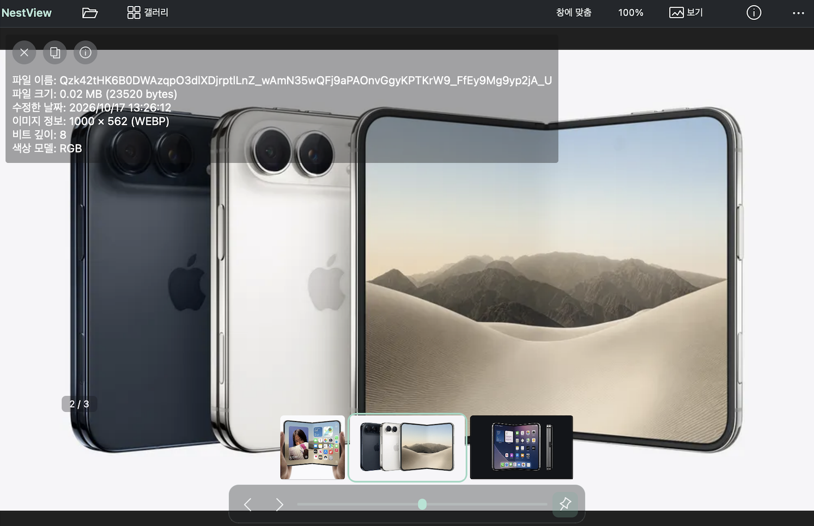

# NestView

사진 탐색과 감상에 집중하는 macOS 이미지 뷰어입니다.



## 주요 기능

- 폴더 갤러리와 필름스트립으로 빠르게 이미지 탐색
- 트랙패드 핀치 확대, 스크롤 이동, 마우스·키보드 조작
- 두 장 보기, 웹툰 연속 보기, 슬라이드쇼
- EXIF 정보, 북마크, PNG·JPEG·WebP 변환
- ZIP·CBZ·RAR·CBR·7z 등 압축파일 안의 이미지 열기
- 새 버전 확인과 서명된 업데이트 설치

## 설치

Apple Silicon Mac과 macOS 15 이상이 필요합니다. [최신 DMG](https://github.com/RilakKuma2/NestView/releases/latest/download/NestView-macOS-AppleSilicon.dmg)를 열고 **NestView.app**을 **응용 프로그램** 폴더로 옮겨 실행하세요.

## 사용

이미지·폴더·압축파일을 창에 끌어 놓아 열 수 있습니다.

| 작업 | 단축키 |
| --- | --- |
| 파일 열기 / 폴더 열기 | ⌘O / F |
| 이전 / 다음 이미지 | ← / → |
| 갤러리 | G |
| 원본 크기 / 창 맞춤 | 0 / 1 |
| 두 장 보기 / 웹툰 보기 | 7 / 5 |
| 이미지 정보 | Tab |
| 설정 | ⌘, |

macOS 상단 **NestView → 업데이트 확인…**에서 새 버전을 확인합니다. 업데이트가 있을 때만 **자동 업데이트**와 **설치 파일 다운로드**를 선택할 수 있습니다. 최신 버전이면 최신 상태라는 안내를 표시합니다. 창의 파일 메뉴에서 백그라운드 업데이트 확인도 켜거나 끌 수 있습니다.

## 소스에서 빌드

Xcode Command Line Tools와 Homebrew가 필요합니다.

```sh
brew install qtbase qttools qtsvg qtimageformats libarchive cmake ninja
./scripts/build-macos.sh
./scripts/package-macos.sh
python3 scripts/package-dmg.py
```

빌드 결과는 `release/NestView.app`에 생성됩니다. 업데이트 배포 설정은 [릴리즈 안내](docs/RELEASING.md)를 참고하세요.

## 원본 프로젝트와 라이선스

NestView는 [qView](https://github.com/jurplel/qView) 7.0을 기반으로 macOS용 UI와 탐색 기능을 확장한 프로젝트입니다. 원본 qView 개발자와 기여자들의 작업에 감사드립니다.

기존 **GNU GPL v3** 라이선스를 유지합니다. [LICENSE](LICENSE)와 [서드파티 고지](docs/THIRD_PARTY.md)를 참고하세요.
